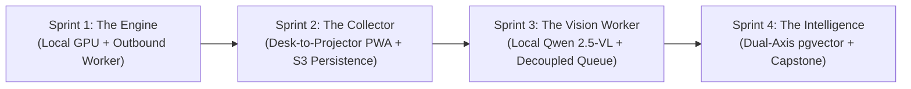

# AI Bootcamp: Systems Architecture, Local Infrastructure & Applied AI

> **Target Learner:** Experienced High-School Educators Across Disciplines (`math`, `science`, `humanities`, `economics`)  
> **Role:** Lead Systems Architect & Product Owner  
> **Platform Support:** Google Antigravity (AGY), Claude Code, OpenAI Codex, Cursor  
> **Curriculum Blueprint:** See [`curriculum_plan.md`](./curriculum_plan.md)  
> **Multi-Subject Technical Spike:** See [`spike/multi_subject_spike_report.md`](./spike/multi_subject_spike_report.md)

---

## Welcome to the Studio

This program is designed for an experienced classroom educator stepping into the role of **Lead Systems Architect**. Whether you teach **Mathematics, Science (Chemistry/Biology), Humanities (History/English), or Social Sciences (Economics)**, you will not be memorizing boilerplate syntax or typing terminal commands.

Instead, you select your **Subject Pack** at the start and direct an autonomous AI agent to design, build, harden, and optimize a production-grade educational platform tailored to your subject:
* Run high-throughput multimodal AI models directly on your home computer's graphics card.
* Build an instant, sub-second desk-to-projector classroom camera app (PWA) for student notebooks, lab sheets, essays, or graphs.
* Decouple presentation time from machine vision compute using an asynchronous task queue.
* Organize student misconceptions using 768-dimensional concept maps (`pgvector`) and an AI analytical assistant.

---

## Pluggable Subject Tracks

> **Same Core Production Experience Across Every Subject:** Regardless of which track you choose, you build the **exact same 4-Sprint production system** — a local GPU inference engine & outbound bridge (Sprint 1), a `< 1s` Desk-to-Projector classroom camera PWA with S3/Postgres persistence (Sprint 2), an asynchronous `Qwen 2.5-VL` handwriting OCR & balanced LLM rubric evaluator (Sprint 3), and a 768-D `pgvector` misconception search & Text-to-SQL assistant (Sprint 4). Only the student notebook worksheets, domain rubric criteria, and teaching analogies adapt to your subject.

At the beginning of Sprint 1, your AI Mentor configures your workspace for your subject track:
* **`math` — Mathematics (Algebra & Functions):** Multi-step equations, sign transposition errors, binomial expansion misconceptions.
* **`science` — Science (Chemistry & Biology):** Cellular respiration equations, sealed-flask conservation of mass errors, photosynthesis biomass misconceptions.
* **`humanities` — Humanities (History & English Argumentation):** Claim-Evidence-Reasoning (CER) paragraphs, evidence-to-claim logical contradictions, wartime primary source bias misconceptions.
* **`economics` — Social Sciences (Microeconomics):** Supply & Demand shock analysis, equilibrium comparative statics errors, demand shift vs. movement-along-curve misconceptions.

---

## How It Works: Sprints & Slices



* **Sprints (The 4 Big Milestones):** Each sprint addresses a major real-world friction. We strongly recommend completing each sprint within a **short, focused time window** (2–3 consecutive evenings or a weekend afternoon) to maintain context and cadence.
* **Slices (Thin Vertical Bricks):** Each sprint is divided into 2–3 thin vertical slices. You lay one brick, test it immediately with the test harness, and ensure zero technical debt before laying the next.
* **Teacher's Field Notes:** Every slice opens with a conversational reflection in your journal (`journal/sprintX_field_notes.md`) to ground the engineering choices in classroom realities.
* **Active Learning & Neutral Trade-Offs:** The mentor presents design options across UI, flow, and system trade-offs neutrally. The choices come from your own evaluation, and you are free to test and iterate.
* **Automated Hardening:** At every sprint checkpoint, the agent conducts an unprompted defensive code review, reporting on loopholes closed and classroom disasters averted.

---

## Quick Start: How to Begin

You can run this bootcamp in any AI coding environment:

### Option 1: Google Antigravity (AGY)
1. Open this repository folder in the **Antigravity Desktop App**.
2. In the chat, simply type:
   > *"I'm ready to start."* (or *"I'm a Chemistry teacher ready to start."*)
3. The built-in Mentor will automatically configure your Subject Pack, run pre-flight diagnostics, introduce Sprint 1, and open your first Field Note conversation.

### Option 2: Claude Code (Anthropic)
1. In your terminal, navigate to this directory and launch Claude Code:
   ```bash
   claude
   ```
2. Type:
   > *"I'm ready to start."*
3. Claude automatically reads `CLAUDE.md` and `AGENTS.md` and takes on the mentor role.

### Option 3: OpenAI Codex / Cursor
1. Open the project. The agent automatically reads `AGENTS.md`.
2. Type:
   > *"I'm ready to start."*

---

## Universal Verification Commands

Your AI agent handles all CLI commands in the background on your behalf. If you ever want to run them manually:

```bash
# View or Switch Pluggable Subject Tracks (math, science, humanities, economics)
python3 -m harness tracks
python3 -m harness select science

# Pre-Flight System & Hardware Doctor
python3 -m harness check 0

# Sprint 1 Checks (The Engine & Cloud Bridge)
python3 -m harness check 1.1    # Local Engine Ignition (> 100 tok/s)
python3 -m harness check 1.2    # Next.js Web Playground & Live Telemetry
python3 -m harness check 1.3    # Hardened Outbound Worker & 401 Attack Test

# Sprint 2 Checks (The Classroom Collector)
python3 -m harness check 2.1    # Desk-to-Projector Fast-Lane (< 1s render)
python3 -m harness check 2.2    # Supabase Persistence & Page Refresh Restore

# Sprint 3 Checks (The Vision Worker)
python3 -m harness check 3.1    # Qwen 2.5-VL OCR & Balanced Null-Hypothesis
python3 -m harness check 3.2    # Asynchronous Decoupling Pipeline

# Sprint 4 Checks (The Intelligence & Capstone)
python3 -m harness check 4.1    # Dual-Axis pgvector Misconception Search
python3 -m harness check 4.2    # Text-to-SQL Assistant & Capstone WebP Optimization
```

---

## Repository Structure

```text
├── AGENTS.md                  # Universal multi-agent mentor specification
├── CLAUDE.md                  # Claude Code entrypoint
├── curriculum_plan.md         # Master curriculum blueprint (Modules 1.0 - 3.7)
├── .agents/rules/             # Antigravity native mentor rule
├── harness/                   # Black-box test suite & diagnostic doctor
│   ├── cli.py                 # Unified CLI runner (`check`, `tracks`, `select`)
│   ├── preflight.py           # Self-healing infrastructure doctor
│   ├── subjects/              # Pluggable Subject Pack registry (math, science, humanities, economics)
│   ├── checks/                # Sliced checkpoint assertion modules
│   └── data/                  # Synthetic student handwriting worksheets across subjects
├── journal/                   # Teacher's Field Notes templates (Sprints 1 - 4)
├── spike/                     # Empirical benchmarks & multi-subject spike reports
└── src/                       # Your clean-slate application workspace
```
