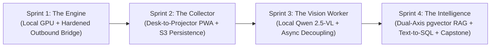
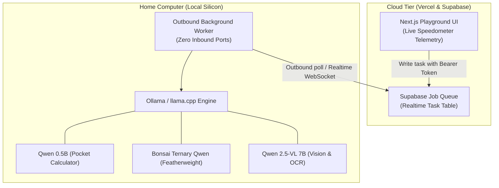
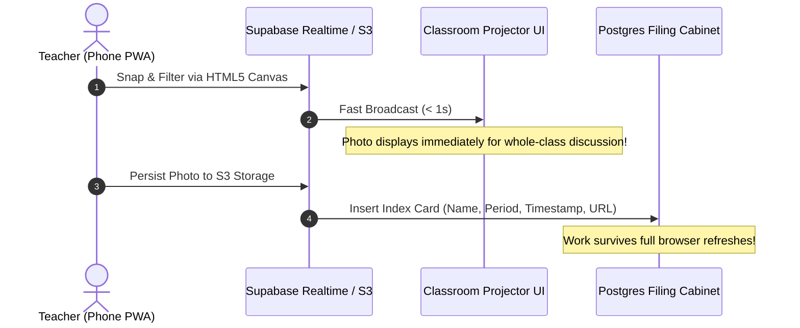
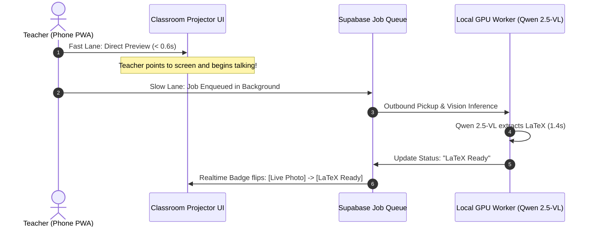
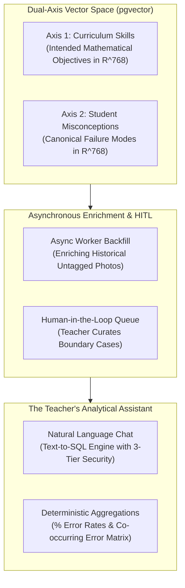

# Master Curriculum Plan: Applied AI Systems, Local Infrastructure & Classroom Intelligence

> **Target Learner:** Experienced High-School Educators Across Disciplines (`math`, `science`, `humanities`, `economics`)  
> **Role:** Lead Systems Architect & Product Owner (Directs the AI agent harness; no manual syntax typing)  
> **Hardware:** Personal Gaming PC / Apple Silicon Mac (Local GPU Acceleration via `ollama` / `llama.cpp`)  
> **Pedagogical Model:** Progressive Disclosure driven by Authentic Engineering Friction + Pluggable Subject Packs  
> **Cadence Guidance:** Strongly recommended to complete each Sprint within a short, focused time window (2–3 consecutive evenings or a single weekend afternoon) to maintain context and momentum.

---

## Executive Summary & Core Philosophy

This bootcamp is structured as a continuous evolutionary journey across four unified sprints. Rather than learning disconnected toys, the learner selects their **Subject Pack** (`math`, `science`, `humanities`, or `economics`) at the start and builds a single cumulative sandbox that evolves into a production-grade educational platform tailored to their classroom.

### Key Principles
1. **Mental Models Over Syntax:** The learner acts as the Architect. The AI agent harness handles dependency installation, code generation, and error fixing. The teacher focuses on data flows, hardware limits, network boundaries, and trade-offs.
2. **Friction-Driven Progression:** Every new tool is introduced only *after* the learner experiences the exact friction caused by its absence (e.g., page refresh data loss demands a database; tunnel URL instability demands an asynchronous worker queue).
3. **Domain-Bridged Mental Models (No Advanced Math Required):** High-dimensional vector spaces (768-Slider Rubric Cards / Chemical Spectra / $\mathbb{R}^{768}$), cosine similarity (Compass Direction / Thematic Alignment / $\frac{\mathbf{u} \cdot \mathbf{v}}{\|\mathbf{u}\|\|\mathbf{v}\|}$), Directed Acyclic Graphs (Lesson Plan Sandbox / Git), and statistical tail distributions (Slowest Lab Group / $p50/p95/p99$) bridge universal teaching craft to deep systems engineering.
4. **Active Learning via Frequent Neutral Choices:** The mentor never prescribes which choice is "better." The learner evaluates trade-offs between UI, flow, and system designs, and is always free to review and iterate based on classroom experience.
5. **Security by Default:** Unprompted code reviews and hardening audits occur at every sprint checkpoint, explaining loopholes closed and dangers averted.

---

## Sprint 1: Infrastructure, Local LLMs & Hybrid Cloud Architecture

### Objective
Demystify how AI runs on silicon, establish a local inference engine on personal hardware, and build a secure, hardened outbound bridge between the home machine and the cloud.

### Module Sequence

#### Module 1.0: Preamble, Subject Track Selection & Harness Setup
* **Focus:** Zero code, zero infrastructure. Selecting the educator's **Subject Pack** (`python -m harness select <math|science|humanities|economics>`), verifying the universal CLI test doctor (`python -m harness check 0`), and initializing the dedicated workspace repository.
* **Outcome:** Clean environment verified; active Subject Track configured; self-healing doctor confirms hardware readiness.

#### Module 1.1: Sandbox Scaffolding & Dependencies (Bootstrap)
* **Tech Stack:** Next.js, React, TypeScript, Tailwind CSS, Python virtual environment.
* **Frontier Integration:** Wire up Google AI Studio (Free Tier Gemini API key via Google SSO) for instant cloud vs. local comparison.
* **Granular Explanations:**
  * *Ollama:* The Engine Block.
  * *Qwen 0.5B:* The Pocket Calculator (tiny, blazing fast for light text checks).
  * *Python Dependencies:* The Digital Toolbox.
* **Outcome:** A running local web app scaffold that serves as the permanent sandbox.

#### Module 1.2: Cloud Infrastructure Ecosystem
* **Providers Connected:** GitHub, Vercel, Supabase, Cloudflare.
* **Concept:** Understanding the "Why" of modern cloud layers with plain-language analogies:
  * *GitHub:* Version control and continuous deployment trigger.
  * *Vercel:* Edge compute and frontend hosting.
  * *Supabase:* The Digital Filing Cabinet (Postgres), Photo Album (S3 Storage), and Task Queue.
  * *Cloudflare:* DNS and secure network tunneling.

#### Module 1.3: The Hybrid Cloud-Local Deployment
* **Implementation:** Expose the local inference engine via Cloudflare Tunnel. Push the Next.js app to GitHub and deploy live to Vercel.
* **Telemetry Dashboard:** The web app displays real-time metrics:
  * Tokens per second ($\text{tok/s}$) for prompt evaluation vs. generation.
  * KV Cache allocation and context window usage.
  * Parameter scale comparison ($0.5\text{B}$ vs. $7\text{B}$ vs. Frontier).
* **The "Aha!" Moment:** Home hardware becomes a private cloud server accessible from a smartphone anywhere.

#### Module 1.4: Cybersecurity, Hardening & Abuse Prevention
* **Concepts:** Security risks of exposing home hardware to the public internet (DDoS, unauthenticated GPU burnout).
* **Hardening Measures:** API token/bearer authentication, IP/origin CORS policies, rate limiting, and `.env` secret hygiene.
* **Checkpoint Audit:** Automated attack simulation verifying unauthenticated requests receive `401 Unauthorized`.

#### Module 1.5: Code Review & The Model "Battleground"
* **Activity:** Side-by-side code review of the production codebase using Gemini 3.8 Flash vs. the local model.
* **Key Lessons:**
  1. *Context Windows in Practice:* Experiencing local context boundaries ($4\text{k} - 32\text{k}$ tokens bound by VRAM) vs. massive frontier context ($1\text{M}+$ tokens ingesting entire repositories).
  2. *Code Review in Agentic Dev:* Why human/AI auditing of generated code is mandatory.

#### Module 1.6: Headless Hosting & Outbound Worker Architecture
* **The Intentional Friction:** Free-tier ad-hoc tunnels rotate URLs upon machine reboot, breaking the connection.
* **The Architectural Shift:** Transition from an inbound tunnel to an **Outbound Worker Pattern** via Supabase Task Queue:
  * The cloud web app posts tasks to a queue.
  * A headless background worker on the home PC maintains an outbound HTTPS connection, pulls jobs, crunches them on the local GPU, and reports answers back.
* **Takeaway:** Zero open inbound router ports, zero URL instability, and complete firewall immunity.

---

## Sprint 2: The Real-Time Desk-to-Projector Classroom PWA

### Objective
Build a practical mobile-first tool for the classroom that captures live student handwriting, displays it on the projector, and introduces state persistence.

### Module Sequence

#### Module 2.1: Pain Point Discovery & Dual-Role UI Design
* **The Problem:** Capturing and sharing live student work on paper without carrying physical notebooks back to a bulky document camera.
* **The Architectural Concept:** **Bifurcated UX Co-Design**:
  * *Desktop View:* Passive, high-visibility presentation canvas for the classroom projector.
  * *Mobile View:* Active, ergonomic, one-handed remote controller with an instant camera shutter.

#### Module 2.2: Ephemeral Transfer & In-Browser Processing
* **E2E Pipeline:** Photo taken on phone $\to$ temporary memory buffer $\to$ displays live on the projector in $< 1\text{s}$.
* **Client-Side Browser Compute:** Using HTML5 Canvas for instant on-device enhancements without servers or AI:
  * Black & White / High-Contrast filter (makes faint pencil marks pop on dim projectors).
  * Annotation and pen markup tools directly on the display.
* **The Intentional Friction:** Storage is strictly ephemeral. A browser refresh completely wipes the work! This creates an immediate hunger for persistent storage.

#### Module 2.3: Persistence — Postgres DB & Object Storage
* **Implementation:** Provision Supabase Postgres (`id`, `class`, `student_name`, `image_url`, `timestamp`) and Supabase S3 Object Storage for the image files.
* **Architectural Separation:** The High-Res Photo Album (S3 Storage) keeps large binary files off the relational database, while the Digital Filing Cabinet (Postgres) manages lightweight index cards.
* **The "Content-Blind" Friction:** The dashboard can filter deterministically by class, date, or student name, but **cannot** search by math topic, equation, or error type. The database is blind to the content of the image.

---

## Sprint 3: The Vision Worker & Asynchronous Decoupling

### Objective
Solve the "content-blind" database problem by adding local vision AI, experiencing the painful 18-second classroom freeze, and implementing the asynchronous fast/slow lane decoupling.

### Module Sequence

#### Module 2.4: Vision Worker & The Baseline "Zero-Shot" Attempt
* **Implementation:** The local background worker feeds student photos to **Qwen 2.5-VL 7B** via GPU to transcribe handwritten math into LaTeX.
* **The Reality Check:**
  * 100% optical character recognition on handwriting, fractions, and superscripts (~150 tok/s).
  * *The "Error Hunter" Trap:* When asked naively *"Is there an error? Find it"*, the model exhibits sycophancy/false-positive bias on 100% correct student work.
  * *The Fix:* Balanced null-hypothesis prompt with verification by substitution.

#### Module 2.5: The Conscious Engineering Choice — Deferring Micro-Optimization
* **Pedagogical Decision:** Rather than getting bogged down in endless prompt-engineering tweaks, recognize baseline characteristics and **intentionally hold off** on micro-optimization. Establish that architectural solutions trump prompt tweaks.
* **Artifact:** Establish the automated local **Evaluation Suite** (our ground-truth test worksheets).

#### Module 2.6: The Synchronous Pipeline Block (The Pain)
* **The Experience:** Wire the pipeline so that the projector screen *waits* for the full upload + VLM extraction + DB update before rendering.
* **The Friction:** Teacher and 30 students stare awkwardly at a 12–18 second loading spinner in silence. The lesson grinds to a halt.

#### Module 2.7: The Architectural Shortcut — Asynchronous Decoupling
* **The Refactor:**
  * **Sync Fast Lane (< 1s):** Image uploads and renders on the projector immediately. The teacher starts talking.
  * **Async Slow Lane (Background):** The local worker picks up the job, extracts LaTeX, and updates the database quietly with a status badge (`Live Photo` $\to$ `Transcribing...` $\to$ `LaTeX Ready`).
* **Core Takeaway:** Decoupling Presentation Time from Machine Compute Time.

#### Module 2.8: Hardening & Code Review (Definition of Done)
* File type/size guards on uploads (10MB ceiling, MIME validation), LaTeX sanitization against XSS (`\input`, `\write18` stripped), dead-letter poisoned queue recovery, and automated code review report.

---

## Sprint 4: Grounding, Dual-Axis RAG & The Personal Analytical Assistant

### Objective
Solve the semantic search problem using high-dimensional vector spaces (`pgvector`), curate boundary cases with active learning, launch the 3-tier analytical assistant, and conclude with an autonomous engineering optimization capstone.

### Module Sequence

#### Module 3.1: Front-Loading the Affordance Scenarios
* **The Hook:** Demonstrating what becomes possible when student work is semantically grounded:
  * Cohort analytics: *"52% of students made this bracket sign error this month."*
  * Semantic retrieval: *"Find all student work struggling with negative exponents."*
  * Automated remedial grouping based on shared misconceptions.

#### Module 3.2: Dual-Axis Vector Grounding & `pgvector`
* **Infrastructure:** Enable `vector` extension in Supabase Postgres.
* **The Dual-Axis Representation:**
  * **Axis 1 (Skill Axis):** Curriculum learning objectives ($\mathbb{R}^{768}$).
  * **Axis 2 (Error Axis):** Canonical student misconception taxonomy ($\mathbb{R}^{768}$).
* **Low-Friction Setup:** Teacher inputs a 1-page topic list; AGY generates a paired Misconception Matrix; the teacher conducts a 2-minute sanity check.

#### Module 3.3: Asynchronous Batch Backfill & Semantic Re-mapping
* **Pipeline:** The local background worker queries untagged historical submissions (`WHERE skill_tag IS NULL`), passes them through Qwen 2.5-VL with RAG context, maps them to the dual axes, and writes vectors to `pgvector`.
* **Result:** Dark photo archives are automatically converted into structured, searchable learning assets overnight.

#### Module 3.4: Human-in-the-Loop (HITL) & Curating Edge Cases
* **Confidence Scoring:** High-confidence items (>85%) auto-file; low-confidence items (<60%) route to a "Needs Review" queue.
* **Active Learning vs. Vector Pollution:**
  * *Standard:* Relational metadata tagging.
  * *Selective Ingestion:* Only promote true **edge cases and boundary examples** into the reference vector base.
  * *Lesson:* "More data $\ne$ better data." Redundant points crowd vector clusters; edge cases expand knowledge boundaries.

#### Module 3.5: The Teacher's Personal Analytical Assistant & The 3-Tier Backend
* **Retire Project 1 UI:** Replace raw telemetry with a dual-pane Analytical Command Center.
* **The 3-Tier Backend Architecture:** Formalizing why heavy analytics and Text-to-SQL must live in a secure server backend (hiding database secrets, preventing phone CPU meltdown, sandboxing SQL to SELECT-only).
* **Features:**
  * *Visual Analytics:* % error breakdown per topic and Co-occurring Error Matrix.
  * *Conversational Text-to-SQL:* Querying student data in natural language (*"Which students failed linear equations on both Monday and Wednesday?"*).

#### Module 3.6: System Observability & Operational Telemetry
* **Shift to Engineering Metrics:** Tracking operational telemetry ($p50/p95/p99$ latencies, worker queue depths, OCR failure logs, token costs) to objectively evaluate adoption and software value.

#### Module 3.7: Capstone Challenge — Long-Horizon Autonomous Optimization
* **The Exercise:**
  1. *Diagnose:* Inspect Module 3.6 telemetry to identify an authentic bottleneck in the stack (e.g., 4MB mobile upload taking 2.8s on school Wi-Fi).
  2. *Propose:* The teacher acts as Lead Architect, proposing an optimization (client-side WebP compression via HTML5 Canvas).
  3. *Implement:* Directs the agent on a new Git feature branch (`feature/client-webp-compression`).
  4. *Evaluate:* Runs the automated local Eval Suite (from Module 2.5) to quantitatively prove the fix (payload shrinks by 95%, upload drops to 0.38s).
  5. *Regression Test & Merge:* Validates that the change caused zero regressions in mathematical accuracy, merges the PR, and triggers production deployment.

---

## Sliced Progression & Verification Matrix

| Sprint | Slice | Focus / Stack | Primary Friction Introduced | Verification Assertion (`python -m harness check <slice>`) |
| :--- | :--- | :--- | :--- | :--- |
| **S1** | **1.1** | Ollama, Qwen, Python | Waking up silicon on desktop | `check 1.1`: Local GPU engine responds at > 100 tok/s |
| **S1** | **1.2** | Next.js, React, Tailwind | Terminal script locked to desk | `check 1.2`: Web dashboard renders live speedometer dials |
| **S1** | **1.3** | Supabase Queue, Worker | Tunnel URLs break on reboot | `check 1.3`: Outbound worker polls queue; 401 attack test passes |
| **S2** | **2.1** | PWA, HTML5 Canvas | Faint pencil marks; bulky cams | `check 2.1`: Phone snap renders on projector in < 1s |
| **S2** | **2.2** | Supabase Postgres & S3 | Browser refresh wipes student work | `check 2.2`: Image saved in S3, record restored on refresh |
| **S3** | **3.1** | Qwen 2.5-VL, Prompts | Database blind to handwriting | `check 3.1`: LaTeX extracted; balanced null-hypothesis passes |
| **S3** | **3.2** | Async Decoupled Queue | 18s classroom freeze waiting for AI | `check 3.2`: Fast-lane renders in < 1s; slow-lane finishes in bg |
| **S4** | **4.1** | `pgvector`, Dual-Axis | Keyword search blind to math concepts | `check 4.1`: Semantic query matches misconception in $\mathbb{R}^{768}$ |
| **S4** | **4.2** | Text-to-SQL, 3-Tier | Database security & heavy stats | `check 4.2`: Natural language query returns error matrix safely |
| **S4** | **Cap** | WebP Canvas Compression | 4MB mobile upload on school Wi-Fi | `check 4.2`: Payload reduced > 90%; 0 OCR regressions |
